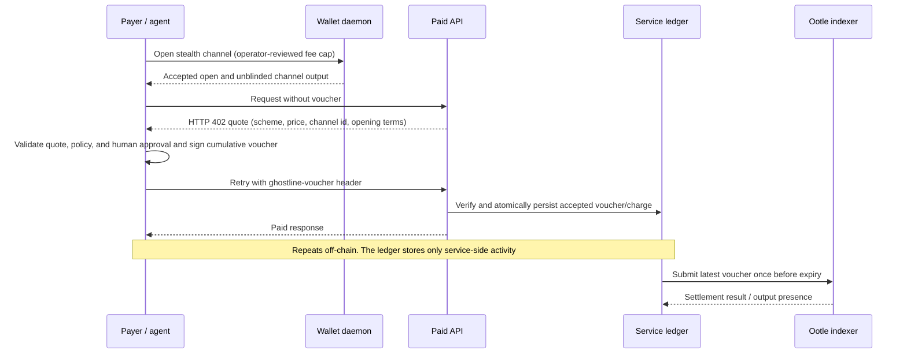

# Ghostline architecture

Ghostline separates per-call accounting from settlement. The payer signs a cumulative voucher for each accepted request; the service keeps the latest voucher in its local ledger and later submits one settlement transaction to Tari Ootle.

## Components

| Component | Responsibility | Crate or package |
|---|---|---|
| Channel template | Verify the payer signature and channel identity, enforce the deposit ceiling, and direct settlement or expiry refund outputs | `ghostline_channel` (on chain) |
| Core | Derive channel ids, encode/sign/verify vouchers, and track payer and service cumulative totals | `ghostline-core` |
| Transaction SDK | Build stealth condition trees, settle/refund statements, and unblind stealth outputs | `ghostline-sdk` |
| Network adapter | Read epoch and substate status from an indexer; call a local wallet daemon for fee quotes and submission | `ghostline-net` |
| Policy engine | Enforce operator budgets, per-call caps, vendor allowlists, rate limits, and configured human approval; optionally persist decision records | `ghostline-policy` |
| HTTP paywall | Quote a request, verify a voucher, and persist accepted service-side state | `ghostline-paywall` |
| Reference payer/API | Demonstrate HTTP 402 negotiation and paid `/fortune` and `/meter` routes | `ghostline-paid-api` |
| MCP server | Expose payment, channel-file, inspection, and close operations over MCP stdio | `ghostline-mcp` |
| TypeScript package | Match Rust channel-id and voucher encodings, signing, and verification; it does not open or submit Ootle transactions | `@ghostline/sdk` |

## Payment sequence

The payer opens a stealth channel through walletd and requests the API. The API returns a 402 quote. The payer checks policy, signs a cumulative voucher and retries. The service verifies and records the voucher before replying. Requests repeat off-chain. Before expiry, the service submits the latest voucher once and checks the indexer result.

The service ledger and payer session are separate files/process state. The service must retain its latest accepted voucher for settlement. The payer session retains the cumulative signing state and must not be shared by unrelated channels. The service sees requests and call-level prices; the privacy property concerns what third parties can infer from the chain, not what the service knows.

## Channel identity and voucher

`ChannelParams` binds the network tag, payer public key, deposit in integer micro-units, payer spend-condition root, and a 32-byte nonce into a 32-byte channel id using the versioned channel-id domain and Blake2b-256. The recipient key and expiry are enforced by the spend-condition tree. The channel id is a hash commitment to those parameters, rather than a serialization of them.

The payer creates a fresh-mask Pedersen commitment to the cumulative amount and signs the 32-byte channel id, service output authorization key, and 32-byte commitment (96 bytes total) under the versioned voucher domain. The off-chain voucher also carries the amount and mask so the service can verify the opening and later scan its output. The on-chain witness carries only the commitment, service key, and signature. The mainnet template requires three stealth outputs for the signed service payout, payer change, and the 1% treasury fee. It rejects revealed values and extra channel inputs. Ootle's transfer proofs enforce range and conservation. Settlement closes the channel in one spend and leaves at least 1 µT in payer change.

Amounts are integer micro-units throughout. Metered pricing uses checked multiplication. Rust and TypeScript maintain shared vectors for the supported channel-id and voucher format.

## Policy and persistence boundaries

- The policy process must be outside the agent's authority to modify. MCP and the CLI read policy settings from their process environment; the Rust policy library itself does not authenticate its caller.
- Optional JSONL policy audit records include vendor and private spending details. When configured, an audit write failure prevents the payment decision from succeeding.
- Channel/session files can contain deposit masks or signing state. Treat them as secrets. CLI `--out` files use owner-only permissions on Unix; shell redirection requires a restrictive `umask`.
- The paywall persists its latest voucher and accepted totals before returning success. A failed persistence operation must not advance in-memory accounting.
- The wallet daemon signs/submits transactions and pays public fees. Indexer responses inform status but are not a substitute for checking the final transaction result.

## What the chain reveals

An unopened stealth output hides its amount and owner. Fresh Esmeralda settlement and expiry-refund transactions using the claim-free SDK finalized with no covenant claims or plaintext amounts; the deposit, service amount, and payer remainder were masked in the tested transaction fields. The branch, opaque channel id, payer and service authorization data, output commitments/count, fees, and timing remain visible. Funding history, fee payer, and later wallet behavior may correlate activity. See [Privacy and observer view](privacy.md) and [Threat model](threat-model.md) for the limits.

## Network coverage

The open, paid-call, settle, and refund paths have finalized mainnet evidence. See the [mainnet quickstart](mainnet-quickstart.md) and [public proof records](https://ghostline-ui.vercel.app/proof/). A continuous `channel watch` retries failed epoch/output reads at its configured interval; `--once` returns the read error immediately. A failed settlement submission stops the command so the operator can check output presence and transaction status before restarting the watcher.

The reference API can expose aggregate Prometheus metrics with `serve --metrics`. It reports HTTP outcomes and counts of configured ledgers and ledgers with accepted vouchers; the latter is off-chain state, not chain settlement confirmation. Metrics contain no per-channel labels or amounts. The endpoint is opt-in because a deployment should choose its own access boundary. The CLI emits structured operation/outcome events for watch, settle, and refund; logs omit channel identifiers, payment amounts, secrets, and paths.

See [Two views](https://ghostline-ui.vercel.app/privacy/) for a simulation of the observer and operator views.
